  

  <a href="https://pivotek.mx"><b>pivotek.mx</b></a> &nbsp;·&nbsp;
  <a href="https://www.linkedin.com/in/benjamin-esponda-garc%C3%ADa-a743051b2">LinkedIn</a> &nbsp;·&nbsp;
  <a href="mailto:beg.empleos@gmail.com">beg.empleos@gmail.com</a> &nbsp;·&nbsp;
  <a href="README.md">English</a>

Soy abogado corporativo mexicano (energía, hidrocarburos y minería, unos ocho años de práctica) y construyo las herramientas alrededor del trabajo legal. Escribo el análisis y también el código que lee el Diario Oficial, encuentra el artículo correcto, hace las cuentas y revisa la respuesta antes de que llegue al cliente.

## Código abierto

  
  
  
  
  
  

## En producción, sin código público

| | |
|:--|:--|
| **[Con Criterio](https://concriterio.mx)** | Kit de IA para abogados en México: guía, 7 plugins de Claude Code por área de práctica y 7 skills de redacción, sobre un corpus curado de leyes y criterios judiciales verificados. A la venta desde noviembre de 2026, con cobro, entrega automática y 101 pruebas automatizadas. |
| **RAG de derecho energético** | Búsqueda sobre 374 instrumentos de derecho energético mexicano, divididos en 11,112 fragmentos según la jerarquía de las leyes, con búsqueda híbrida y un juego de pruebas de regresión. |
| **SupplySense** | Pipeline de datos sobre más de 560,000 contratos públicos que muestra a proveedores de petróleo y gas a dónde va el dinero. |
| **Cuatro sitios web** | [concriterio.mx](https://concriterio.mx), [pivotek.mx](https://pivotek.mx), [casalegado.mx](https://casalegado.mx) y [carocomunicando.com](https://carocomunicando.com). |

La historia completa, con diagramas y trabajo de clientes anonimizado, está en el [portafolio](https://github.com/BEG-lag/portafolio-ia/blob/main/README.es.md) y en [pivotek.mx](https://pivotek.mx).

## Cómo trabajo

- **Cada afirmación legal lleva su fuente y su fecha de corte.** Lo que no está verificado se marca como estimado, supuesto o brecha de dato.
- **Una persona revisa** donde hay firma, dinero o criterio legal.
- **Primero las pruebas.** Juegos de referencia para la búsqueda, ejemplos revisados a mano para las calculadoras y CI en cada repositorio.

## Herramientas

  
  
  
  
  
  
  
  
  
  
  
  

Licenciatura en Derecho (Ibero), Maestría en Derecho de la Empresa (Anáhuac) y MBA (EAE Madrid). Español nativo, inglés profesional. Nada en estos repositorios constituye asesoría legal.
