  

  <a href="https://pivotek.mx"><b>pivotek.mx</b></a> &nbsp;·&nbsp;
  <a href="https://www.linkedin.com/in/benjamin-esponda-garc%C3%ADa-a743051b2">LinkedIn</a> &nbsp;·&nbsp;
  <a href="mailto:beg.empleos@gmail.com">beg.empleos@gmail.com</a> &nbsp;·&nbsp;
  <a href="README.es.md">Español</a>

I'm a Mexican corporate lawyer (energy, hydrocarbons and mining, about eight years of practice) who builds the tools around the legal work. I write the analysis, and I also write the code that reads the Official Gazette, retrieves the right article, runs the numbers and checks the answer before it reaches a client.

### Today in the Official Gazette

<!-- today:start -->

  

DOF, Tuesday, November 17, 2026: <a href="https://dof.gob.mx/nota_detalle.php?codigo=5803873&amp;fecha=17/11/2026">Sentencia dictada por el Tribunal Pleno de la Suprema Corte de Justicia de la Nación en la Controversia Constitucional 120/2026, así como…</a> · 204 notes · FIX 18.5525 · UDI 8.913896 · <a href="https://beg-lag.github.io/dof-diario/">search the archive</a> · <a href="https://github.com/BEG-lag/BEG-lag/blob/main/.github/workflows/today.yml">refreshed every morning</a>
<!-- today:end -->

## Law, compiled

Open-source tools over Mexican law and public data.

  
  
  
  

**Try it:** [DOF archive search](https://beg-lag.github.io/dof-diario/) · [severance calculator](https://beg-lag.github.io/finiquito-mx/) · [federal laws](https://beg-lag.github.io/leyes-mx/)

## Everyday tools

Small, private, useful every day.

  
  
  
  

**Try it:** [¿Hoy circulo?](https://beg-lag.github.io/hoy-circulo/) · [rent increase calculator](https://beg-lag.github.io/aumento-renta/) · [facturas-cfdi](https://beg-lag.github.io/facturas-cfdi/)

Also: [tema-clawds](https://github.com/BEG-lag/tema-clawds), a light theme for the Claude Code app with 64 tiny Clawds playing in 20 SVG scenes.

## Shipped, not public

| | |
|:--|:--|
| **[Con Criterio](https://concriterio.mx)** | An AI toolkit for Mexican lawyers: a guide, 7 Claude Code plugins by practice area and 7 drafting skills, grounded on a curated corpus of statutes and verified court criteria. On sale since November 2026, with payments, automated delivery and 101 automated tests. |
| **Energy-law RAG** | Retrieval over 374 Mexican energy-law instruments split into 11,112 chunks along the hierarchy of the statutes, with hybrid search and a regression test set. |
| **SupplySense** | A data pipeline over more than 560,000 public procurement contracts that shows oil and gas suppliers where the money goes. |
| **Four websites** | [concriterio.mx](https://concriterio.mx), [pivotek.mx](https://pivotek.mx), [casalegado.mx](https://casalegado.mx) and [carocomunicando.com](https://carocomunicando.com). |

The full story, with diagrams and anonymized client work, is in the [portfolio](https://github.com/BEG-lag/portafolio-ia) and at [pivotek.mx](https://pivotek.mx).

## How I work

- **Every legal claim carries its source and cut-off date.** Anything unverified is labeled as an estimate, an assumption or a data gap.
- **People stay in the loop** wherever there is a signature, money or legal judgment.
- **Tests before trust.** Golden sets for retrieval, hand-checked examples for calculators, CI on every repository.

## Stack

  
  
  
  
  
  
  
  
  
  
  
  

Law degree (Ibero), Master's in Business Law (Anáhuac), MBA (EAE Madrid). Spanish native, English professional. Nothing in these repositories is legal advice.
