

  

  

  <a href="https://pivotek.mx"><b>pivotek.mx</b></a> &nbsp;·&nbsp;
  <a href="https://www.linkedin.com/in/benjamin-esponda-garc%C3%ADa-a743051b2">LinkedIn</a> &nbsp;·&nbsp;
  <a href="mailto:beg.empleos@gmail.com">beg.empleos@gmail.com</a> &nbsp;·&nbsp;
  <a href="README.es.md">Español</a>

I'm a Mexican corporate lawyer (energy, hydrocarbons and mining, about eight years of practice) who builds the tools around the legal work. I write the analysis, and I also write the code that reads the Official Gazette, retrieves the right article, runs the numbers and checks the answer before it reaches a client.

### Today in the Official Gazette

<!-- today:start -->

  <a href="https://dof.gob.mx/nota_detalle.php?codigo=5804786&amp;fecha=24/11/2026"></a>

DOF, Tuesday, November 24, 2026: <a href="https://dof.gob.mx/nota_detalle.php?codigo=5804786&amp;fecha=24/11/2026">Acuerdo por el que se determinan los días que se considerarán como inhábiles para efectos de los actos y procedimientos administrativos…</a> · 209 notes · FIX 19.1648 · UDI 8.930151 · <a href="https://beg-lag.github.io/dof-diario/">search the archive</a> · <a href="https://github.com/BEG-lag/BEG-lag/blob/main/.github/workflows/today.yml">refreshed every morning</a>
<!-- today:end -->

## Law, compiled

Open-source tools that read, apply and audit Mexican law.

  <a href="https://github.com/BEG-lag/reforma-al-dia"></a>
  
  <a href="https://github.com/BEG-lag/mcp-leyes"></a>
  
  <a href="https://github.com/BEG-lag/ley-energia-mx"></a>

**Try it:** [AI reform scoreboard](https://beg-lag.github.io/reforma-al-dia/) · [federal laws](https://beg-lag.github.io/leyes-mx/) · [energy regulation by article](https://beg-lag.github.io/ley-energia-mx/)

## Open data

Public records turned into living datasets, APIs and visual stories.

  <a href="https://github.com/BEG-lag/constitucion-viva"></a>
  <a href="https://github.com/BEG-lag/radar-energia"></a>
  <a href="https://github.com/BEG-lag/modelos-al-dia"></a>
  <a href="https://github.com/BEG-lag/indicadores-mx"></a>
  <a href="https://github.com/BEG-lag/dof-diario"></a>

**Try it:** [Constitution time machine](https://beg-lag.github.io/constitucion-viva/) · [indicators API](https://beg-lag.github.io/indicadores-mx/) · [energy radar](https://beg-lag.github.io/radar-energia/) · [AI models compared](https://beg-lag.github.io/modelos-al-dia/) · [DOF archive search](https://beg-lag.github.io/dof-diario/)

## Everyday tools

Small, private, useful every day.

  <a href="https://github.com/BEG-lag/hoy-circulo"></a>
  <a href="https://github.com/BEG-lag/aumento-renta"></a>
  <a href="https://github.com/BEG-lag/pension-imss"></a>
  <a href="https://github.com/BEG-lag/finiquito-mx"></a>
  
  <a href="https://github.com/BEG-lag/mis-laboratorios"></a>

**Try it:** [¿Hoy circulo?](https://beg-lag.github.io/hoy-circulo/) · [rent increase](https://beg-lag.github.io/aumento-renta/) · [pension](https://beg-lag.github.io/pension-imss/) · [severance](https://beg-lag.github.io/finiquito-mx/) · [facturas-cfdi](https://beg-lag.github.io/facturas-cfdi/) · [mis-laboratorios](https://beg-lag.github.io/mis-laboratorios/)

## For Claude Code

How I work, packaged for anyone.

  
  

## Shipped, not public

| | |
|:--|:--|
| **[Con Criterio](https://concriterio.mx)** | An AI toolkit for Mexican lawyers: a guide, 7 Claude Code plugins by practice area and 7 drafting skills, grounded on a curated corpus of statutes and verified court criteria. On sale since November 2026, with payments, automated delivery and 101 automated tests. |
| **SupplySense** | A data pipeline over more than 560,000 public procurement contracts that shows oil and gas suppliers where the money goes. |
| **Four websites** | [concriterio.mx](https://concriterio.mx), [pivotek.mx](https://pivotek.mx), [casalegado.mx](https://casalegado.mx) and [carocomunicando.com](https://carocomunicando.com). |

The full story, with diagrams and anonymized client work, is in the [portfolio](https://github.com/BEG-lag/portafolio-ia) and at [pivotek.mx](https://pivotek.mx).

## How I work

- **Every legal claim carries its source and cut-off date.** Anything unverified is labeled as an estimate, an assumption or a data gap.
- **People stay in the loop** wherever there is a signature, money or legal judgment.
- **Tests before trust.** Golden sets for retrieval, hand-checked examples for calculators, CI on every repository.

## Stack

  
  
  
  
  
  
  
  
  
  
  
  

Law degree (Ibero), Master's in Business Law (Anáhuac), MBA (EAE Madrid). Spanish native, English professional. Nothing in these repositories is legal advice.
